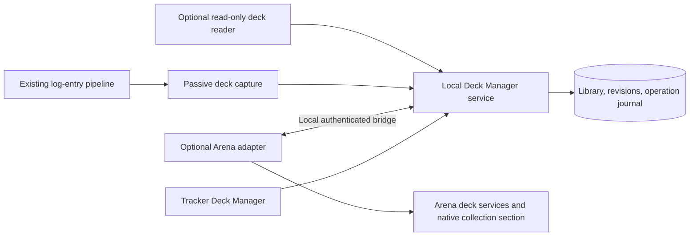

# Deck Manager: a local library beyond Arena's deck limit

Status: research and proposed implementation; nothing implemented or installed.
Researched 2026-10-06 against current source, public projects, and a read-only
inspection of the local macOS Steam Arena installation and Player.log.

## Recommendation

Build a persistent **Deck Manager** in Tapps Tracker with an optional integration
inside Arena. Both surfaces use the same library. Arena keeps its normal active
deck limit; the library stores additional decks locally, with no product-imposed
deck-count limit. Moving a deck to the library frees an Arena slot. Restoring a
deck creates an ordinary Arena deck and consumes a slot.

The desired native section below **Starter Decks** is technically credible:
an existing Windows mod implements a very similar feature. However, the local
macOS Arena uses IL2CPP, while that mod uses Mono. Start with a bounded
compatibility experiment before promising seamless integration on both OSes.
The archive and dashboard remain useful if a particular Arena build cannot
support the native integration.

**First deliverable:** a platform feasibility report with current-build evidence
for complete deck enumeration, exact capture, and the native section. A
controlled save/delete/restore round trip follows only in a user-approved test
session. This research did not modify Arena, read process memory, delete decks,
or stop the game or tracker.

## Findings and confidence

### A close implementation already exists on Windows

[MTGA Enhancement Suite's local-deck release](https://github.com/MayerDaniel/MTGA-Enhancement-Suite/releases)
introduced local decks and conversion between local storage and Arena. The
original repository now directs users to
[Beligal's maintenance fork](https://github.com/Beligal/MTGA-Enhancement-Suite).
That fork documents BepInEx 5 and a fix for Arena's Unity 6.3 update. Its code
is a concrete design reference, not proof that our integration runs today.

Source inspected at fork commit `2a0647cf40adde49686d1c0c8957c147114ccb9c`:

| Source | What it establishes |
| --- | --- |
| [DeckViewSelectorPatch.cs](https://github.com/Beligal/MTGA-Enhancement-Suite/blob/2a0647cf40adde49686d1c0c8957c147114ccb9c/Plugin/Patches/DeckViewSelectorPatch.cs) | Clones Arena's folder UI, places Local Decks at the bottom, and renders native deck tiles. |
| [LocalDeckConverter.cs](https://github.com/Beligal/MTGA-Enhancement-Suite/blob/2a0647cf40adde49686d1c0c8957c147114ccb9c/Plugin/Features/LocalDeckConverter.cs) | Uses DecksManager.GetFullDeck/DeleteDeck/CreateDeck and the runtime deck-limit checks. |
| [LocalDeckBridge.cs](https://github.com/Beligal/MTGA-Enhancement-Suite/blob/2a0647cf40adde49686d1c0c8957c147114ccb9c/Plugin/Features/LocalDeckBridge.cs) | Uses Arena's own export/import helpers and reconstructs tile models. |
| [DeckBuilderSavePatch.cs](https://github.com/Beligal/MTGA-Enhancement-Suite/blob/2a0647cf40adde49686d1c0c8957c147114ccb9c/Plugin/Patches/DeckBuilderSavePatch.cs) | Intercepts saves for synthetic local deck IDs. Native archive editing is possible, but adds another patch surface. |

Keep this reference narrow. It demonstrates how to use the client's deck
services and UI. It does not establish an officially supported extension API
or macOS compatibility. The fork declares MIT in its README; verify the license
grant and retain attribution before copying any implementation.

### The current Mac build needs a different integration

Local observations, obtained without attaching to the process:

- Player.log reports Unity `6000.3.14f1`.
- The announced app data directory contains `il2cpp_data`, without a `Managed`
  directory. The app contains `GameAssembly.dylib`.
- Both the executable and GameAssembly have x86_64 and arm64 slices. This
  establishes available binary architectures, not which architecture is running.

The Mono plugin cannot be installed unchanged into this build. BepInEx's
[IL2CPP installation guide](https://docs.bepinex.dev/master/articles/user_guide/installation/unity_il2cpp.html)
and [available builds](https://builds.bepinex.dev/projects/bepinex_be) are starting
points; macOS loader, interop, architecture and signing behavior must be proven
on Arena. An [upstream macOS IL2CPP issue](https://github.com/BepInEx/BepInEx/issues/1373)
reports initialization failures in another game, so a listed download is not
enough to establish working support. Do not make Rosetta a dependency without
testing and documenting the actual launch path.

There is a promising route for **reading** decks independently of injection:
[mtga-reader](https://github.com/mtgatool/mtga-reader) reports typed deck readers
for Windows/Mono and macOS/IL2CPP. Its
[Mac backend notes](https://github.com/mtgatool/mtga-reader/blob/main/docs/MACOS_IL2CPP.md)
describe the DecksManager object graph and per-pile lists. These are upstream
claims, not tests conducted here. A reader can support capture; it does not
perform persistent save/delete operations or add UI. Evaluate its GPL-3.0
license, native-helper packaging and macOS permissions before adopting code.

### Logs offer useful capture signals, but not seamless control

Read-only inspection of the current local log found these actual messages:

| Signal | Observed shape and implication |
| --- | --- |
| DeckGetDeckSummariesV3 response | Summaries with DeckId, Name, Attributes, art and cosmetics. No card piles in the observed response. Useful catalog, insufficient to archive a deck. |
| DeckUpsertDeckV3 outgoing request | Summary plus Deck.MainDeck, Sideboard, CommandZone, Companions and CardSkins. Useful full-deck capture candidate when a deck is saved. |
| DeckUpsertDeckV3 response | Deck summary. Pair with the request; an outgoing request alone does not prove a successful save. |
| DeckDeleteDeck outgoing request | DeckId. A request alone does not prove deletion. |

The observed summary response contained **185 entries**. That is not proof of
185 user-created slots: summary catalogs and capacity accounting can include
different deck classes. Treat 100 as the reported user-deck limit, and use
Arena's actual current capacity decision when available. Never calculate free
slots as `100 - len(all summaries)`.

This repo already groups multiline log entries in `log_entry.py` and parses
deck metadata in `tracker_opening_deck.py`. Extend those paths rather than
building another Player.log tailer. Capture fixtures must be scrubbed; only
schema keys and counts were printed during this research.

## Options

| Approach | Complete initial deck capture | Move/restore | Native section below Starter Decks | Assessment |
| --- | --- | --- | --- | --- |
| Log capture + clipboard | Not established; summary lists lack cards, unsaved decks may never be captured | User imports/deletes in Arena | No | Reliable foundation and manual fallback, but falls short of the seamless goal. |
| Read-only runtime reader + clipboard | Promising on both OSes; validate completeness and cache loading | User imports/deletes in Arena | No | Useful way to get all decks without a game UI patch. |
| OS UI automation | Can potentially export decks one at a time | Can potentially drive Import and Delete | No | Depends on focus, screen layout and dialogs. Investigate only as an assisted fallback; not the primary bulk-management design. |
| Optional in-process deck integration | Can call the client's full-deck service | Can call the normal client services | Yes | Closest match. Windows precedent; Mac IL2CPP proof required. Recommended target. |
| Independent calls to Arena's private server protocol | Unverified authenticated protocol | Potentially | No | Adds session handling and protocol maintenance without solving the native UI. Do not pursue first. |
| Raw memory writes or patching the displayed limit | Cache changes do not establish persistence | Not reliably | Requires further invasive work | No demonstrated benefit over client-service integration. Exclude from the design. |

The supported manual restore mechanism is clipboard text followed by Arena's
Import button, documented in [Wizards' import guide](https://mtgarena-support.wizards.com/hc/en-us/articles/360049857771-Importing-a-Deck).
No supported programmatic deck-write API was identified in this research.

## User experience

### In Tapps Tracker

Add **Deck Manager** beside Deck Finder in the sidebar and tray/menu, opening
`#/deck-manager`. Preserve the existing Decks analytics view: played-deck
statistics are not the complete current Arena catalog.

Show a searchable tile/list browser with **All**, **In Arena**, and **Stored**
views. Display art, name, format, colors, card count, tags, saved date and last
confirmed Arena presence. Filters include Midweek Magic and Limited. The detail
pane shows all card sections, revisions and notes, with these actions:

- **Save a copy:** back up the current complete deck without freeing a slot.
- **Store in collection:** save and verify it, then remove that specific Arena
  deck. This frees a slot only after confirmed removal.
- **Move to Arena:** restore the selected saved revision. Keep the backup.
- **Remove from collection:** local trash with undo; it never deletes an Arena
  deck. Use a separate explicit command for removing an active Arena deck.
- **Copy for Arena / export file:** available even without the integration.

Show the account and verified slot usage, or **Capacity unknown** when it cannot
be established. At capacity, offer **Choose a deck to store first**. Preview
both decks and require one explicit action for the swap; never choose a victim.

### Inside Arena

The target order is:

```text
Your Decks                  [Arena's existing section]
Starter Decks               [Arena's existing section]
Tapps Collection            [new local section]
```

Stored tiles look like decks but indicate **Stored**. Provide **Move to Arena**
on a stored deck and **Store in collection** on a normal user deck. The actual
installation's labels and folder structure determine placement: insert after
the starter section rather than relying on a hardcoded child index.

Archived decks are viewable but cannot enter a queue until restored. Start with
viewing and transfers. Editing them in Arena's real deck builder is a later
phase because save interception and synthetic identities need additional tests.
Initially, a stored deck can be edited by restoring it, editing in Arena and
saving another revision.

### When Arena is closed

The local library remains viewable, searchable and exportable. Local notes,
tags and backups can also work offline. Fresh capture and changing Arena's
deck roster require Arena open, authenticated, connected and in an appropriate
home/decks scene. Merely finding the game process is insufficient. Disable
transfer actions during matches, queueing, sideboarding and incomplete loads.

The in-game section requires loading the optional integration at game startup;
installation may require an Arena relaunch in an agreed maintenance session.
Never stop or restart the user's active Arena or tracker automatically.

## Architecture and persistence

Use Python as the sole persistent library writer and operation coordinator.
The React dashboard and small Arena adapter share this service. Keep the live
tracker log-only; process access and Arena writes belong to an explicit,
optional Deck Manager capability, separate from GRE tracking.



Proposed modules, refined after the feasibility experiment:

| Location | Responsibility |
| --- | --- |
| `src/mtga_tracker/deck_manager.py` | Validation, revisions, transfers, reconciliation and account boundaries. |
| `src/mtga_tracker/deck_manager_api.py` | Dashboard requests and background jobs, using existing job patterns. |
| `src/mtga_tracker/deck_capture.py` | Catalog/full-deck log signals, request/response correlation, limited-event captures. |
| `src/mtga_tracker/analytics_persistence.py` | Library write helpers; numbered schema migrations stay in analytics.py. |
| `deck-manager-bridge/` | Optional minimal platform adapter; naming and loader chosen after the experiment. |
| `ui/src/components/DeckManagerPage.tsx` | Library browser and transfer/recovery flows. |

Reuse the existing card-image, mana-symbol and Deck Finder detail components
where appropriate. `ui/src/deckFinderImport.ts` is deliberately a display-only
parser that strips printing suffixes; it must not become the authoritative
archive serializer. Likewise, `dashboard._deck_export_snapshot` is useful for
historical imports but does not enumerate the live Arena catalog. New capture
must retain printing IDs, all piles and original portable text independently.

Proposed tables in the existing selected `--db` database:

- `managed_decks`: stable random local UUID, owner account key, name, tags,
  notes, current revision, timestamps and local trash state.
- `managed_deck_revisions`: immutable revision UUID, parent revision, complete
  normalized payload, portable import text, content hash, provenance, completeness,
  captured format/event/set metadata and timestamp.
- `managed_deck_cards`: revision, pile, quantity, Arena grpId, name and known
  printing identifiers. Distinguish main, sideboard, commander and companion.
- `managed_deck_bindings`: local deck, account, authoritative Arena DeckId,
  observed hash, observation time and confirmed/unknown presence. Allow multiple
  bindings; two identically named decks are not automatically the same deck.
- `managed_deck_operations`: operation UUID, requested revision, account/session,
  source/destination IDs, state, timestamps and scrubbed error/recovery evidence.

Preserve raw deck-specific fields alongside normalized data, including cosmetics
when observed. Store no access tokens or unrelated inventory/account data. Preserve
unknown deck fields for future readers without blindly resubmitting them to Arena.
Normalize through a version-specific adapter that regenerates server identities
and session-dependent attributes.

Names are labels, never keys. Content hashes include pile boundaries and quantities;
keep exact printing/cosmetic fidelity separately from a gameplay-equivalence hash.
Identical decklists may intentionally have separate names and notes. Unknown cards
must remain in the archive, never be dropped to produce an apparently valid import.

Keep collection revisions independent of `game_deck_cards`. Gameplay snapshots
must remain immutable when a managed deck is renamed, restored or edited.
Historical submitted lists can seed **Historical snapshot** entries, but cannot
establish the latest unplayed revision or complete roster.

### Local bridge

Expose narrow operations: handshake/capabilities, enumerate, fetch complete deck,
create deck, remove deck, and refresh/verify. The adapter queues Unity work onto
the game thread; network or disk waits must not block it. Require build/backend,
account/session and supported-method checks before enabling write capabilities.

Reuse the tracker-selected dashboard port only with a dedicated authenticated
bridge channel: loopback binding, a per-session secret outside page JavaScript,
request IDs, bounded payloads and same-origin/CSRF protections for dashboard
mutations. Do not expose a generic method invocation or memory-write endpoint.
Serialize roster changes per account, and invalidate commands when the account
or session changes. Tokens for this local bridge are not Arena credentials.

If the tracker is unavailable, show the last cached library as read-only inside
Arena and disable transfers. Do not create a second authoritative file store
inside the plugin. Where possible cache portable deck data for tile rendering;
if the game's importer changes quantities, that rendered model cannot become
the archived source of truth.

## Transfers must survive interruption

Local persistence and Arena writes cannot form one atomic transaction. Use a
durable journal and explicit reconciliation; a timed-out promise is **unknown**,
not proof that the server rejected the operation.

### Store a deck

1. Obtain the current complete deck and confirm its account, ID and content.
2. Commit an immutable local revision and operation record. Read it back and
   verify all piles and the hash. A summary-only or inferred list cannot pass.
3. Recheck that the Arena deck still matches the captured revision. If it changed,
   capture the new revision or ask the user to review; do not delete stale content.
4. Request removal of that exact DeckId through the normal client service.
5. Verify absence from a fresh authoritative roster, not an incomplete cache.
   Update presence and capacity only when confirmed. Keep the local copy on
   success, failure or uncertainty.

### Restore a deck

1. Confirm a complete revision, current account and available capacity; check
   whether the requested restoration already exists from an interrupted job.
2. Create a new normal Arena deck through the client service. Preserve contents
   even when cards are unowned; never spend wildcards or substitute cards silently.
3. Obtain the authoritative resulting DeckId, fetch the saved deck and compare
   all piles. Preserve supported name/format/cosmetics and report metadata gaps.
4. Record the binding only after verification. Retain the archive permanently
   until the user explicitly removes it from the collection.

An operation UUID makes retries recognizable locally, but Arena may not support
idempotency keys. If create times out, refresh and reconcile before retrying.
When the outcome cannot be determined, show **Needs review** rather than issuing
another create or guessing success from a name match.

### Swap while full

Verify the incoming saved revision first. Archive and verify the selected outgoing
deck, remove it, verify the free slot, then restore and verify the incoming deck.
If restore fails, both lists remain preserved locally and the freed slot remains
visible. Offer recovery; do not automatically recreate or delete additional decks
while an earlier server outcome is uncertain. A swap cannot be advertised as an
atomic server operation.

Bulk operations show per-deck outcomes and stop on account changes or unresolved
capacity. Local trash/undo restores library entries; undoing an Arena removal
requires a new create and a free slot. Do not imply instant server undo.

## Midweek Magic, draft and special decks

Deck preservation must be independent of whether a game is tracked. The existing
Midweek Magic exclusion applies to gameplay analytics; a requested complete MWM
deck capture may still enter this library without persisting an excluded game.

Capture full event submissions or authoritative event/course decks when available.
For limited decks, preserve the submitted main list and separately identify the
unused pool/sideboard and event context. If only the main list is available, label
that scope honestly. Do not synthesize a full list from cards drawn or revealed.

A saved draft list preserves a record for viewing or export. Restoring it as a
normal deck does not reopen a finished event or recreate its card pool. For Cube
and phantom events, cards may not belong to the player's collection; preserve
the exact list and let Arena determine whether/how it can be imported. Keep the
historical format separate from current legality. Midweek event rules can expire.

Provide explicit **Save this event deck** first. Optional automatic event-deck
backups can follow with deduplication and visible scope; they must not bypass the
untracked-match gates or add rows to the normal game statistics.

## Backups, accounts and packaging

Include the library in `.tappsbackup` export/restore and define merge rules before
shipping archive-and-remove. Existing `backup.merge_snapshot_into` copies
game/session-linked rows; it will currently skip these proposed independent
tables. Add explicit library merge handling, including UUID collisions with
different contents, retained revisions and metadata conflicts. Do not blindly
merge or resume pending operations, or treat copied Arena bindings as fresh.

Account switches invalidate observations. Scope transfer actions to the current
Arena account; allow an explicit portable copy to another account, with its own
ownership/legality checks. Never infer account identity from a display name.

Build the optional adapter separately and stage it with existing OS packaging.
Install/uninstall only known adapter files; preserve archives and other installed
mods. Parameterize game assembly references through existing install discovery
in `paths.py`. Never redistribute proprietary Arena assemblies. Keep startup
discovery cheap and perform full reads in explicit background jobs.

Test loader coexistence with Enhancement Suite before enabling both; duplicate
folder/save patches can interfere. Pin dependencies, provide a straightforward
disable/uninstall path, and detect unknown client builds. No silent engine or
gameplay patches. Do not apply a signing workaround or change security settings
merely to force installation.

## Implementation sequence and decision gates

| Phase | Work | Exit evidence |
| --- | --- | --- |
| 0 — Current-build feasibility | Inspect platform/backend; capture scrubbed catalog/full-deck fixtures; test read-only enumeration; test a minimal native folder on Windows and macOS in a scheduled session. Compare an IL2CPP adapter with a reader plus assisted transfer on Mac. | Document all-user-deck coverage, missing fields, runtime capacity, account isolation, loader/relaunch requirements and platform results. Native support is promised only where demonstrated. |
| 1 — Durable library | Tables, immutable revisions, text import/export, exact validation, account scoping, dashboard/menu, event-deck capture, backup/merge/trash. | Save and reopen complete constructed, Brawl, MWM and draft lists. Archives survive restart and backup round trips. No Arena writes yet. |
| 2 — Controlled transfers | Native client-service adapter, journal, single-deck store/restore, fresh verification, full-slot swap and recovery. | Approved disposable-deck tests establish round-trip fidelity and interruption recovery. No deletion before durable verification. |
| 3 — Native collection section | Folder after Starter Decks, native tiles, transfer actions, disabled queue selection, dashboard/native consistency. | The same library and transfer state appear in both UIs; unsupported builds retain dashboard/manual access. |
| 4 — Convenience | Bulk selection, revision comparisons, opt-in event backups, Deck Finder “Save to collection”; native local editing only after separate validation. | Each feature preserves card fidelity and recovery behavior under account switches and client updates. |

Windows is the strongest candidate for the first native proof. Mac feasibility
must still be tested early, since it is the locally observed platform. A successful
Windows demo is not a substitute for the Mac experiment. If the Mac UI adapter
fails, document that result and offer the dashboard/read-only-reader/manual path;
do not present that fallback as fulfilling the requested native category.

Wizards' current [terms, including the Arena EULA](https://company.wizards.com/en/legal/terms)
restrict unauthorized modifications, connections and reverse engineering. The
existence of a mod does not establish permission to distribute this integration.
Resolve that specific release question before distributing the optional adapter;
the supported clipboard library can proceed independently. This research does
not establish Wizards approval or predict account enforcement.

## Validation when implemented

- Exact round trips: 60-card decks, Bo3 sideboards, commander/partner commanders,
  companions, double-faced cards, digital/rebalanced cards, duplicate names,
  specific basic-land printings, cosmetics, localized exports and missing cards.
- Capture coverage: unused/unsaved decks, initially uncached full lists, partial
  catalogs, log rotation, request success/refusal/timeout, event-course decks,
  excluded MWM games and drafts with separately captured pools.
- Failure recovery: disk-full and permission errors before deletion; disconnect
  after a server commit; process/tracker closure at every journal step; account
  switch; external deck edit/delete; duplicate clicks and uncertain create results.
- Capacity: below/at/above the reported limit; starter, net and event decks;
  two simultaneous requests for the last slot; a full-slot swap whose restore fails.
- UI/packaging: Windows standalone/Steam/Epic and Mac supported architectures;
  narrow dashboard layouts; missing adapter, closed game and in-match states;
  uninstall; client update; conflicting mods; library still usable without Arena.
- Run the Python and UI checks listed in AGENTS.md after implementation. Adapter
  tests need deterministic model/service fixtures plus approved real-client smoke
  tests. Do not run automated destructive tests against the user's existing decks.

## Remaining questions for the first experiment

1. Which current Mac IL2CPP loader/interop path can render the section and invoke
   deck services without destabilizing Arena or requiring unacceptable setup?
2. Can every user deck be fetched completely, even if never opened this session?
3. Which roster read proves freshness and which deck classes consume capacity?
4. Do current import/create paths preserve unowned cards, printings, all piles
   and cosmetics? Upstream comments about importer clamping are not a fidelity test.
5. Can event decks be captured before an event ends, including unused limited cards?
6. How are server success and authoritative resulting DeckId obtained reliably
   after timeout, and what limitations remain for reconciliation?

These questions determine the adapter and platform scope. They do not prevent
designing the durable library, dashboard and exact archival format now.
